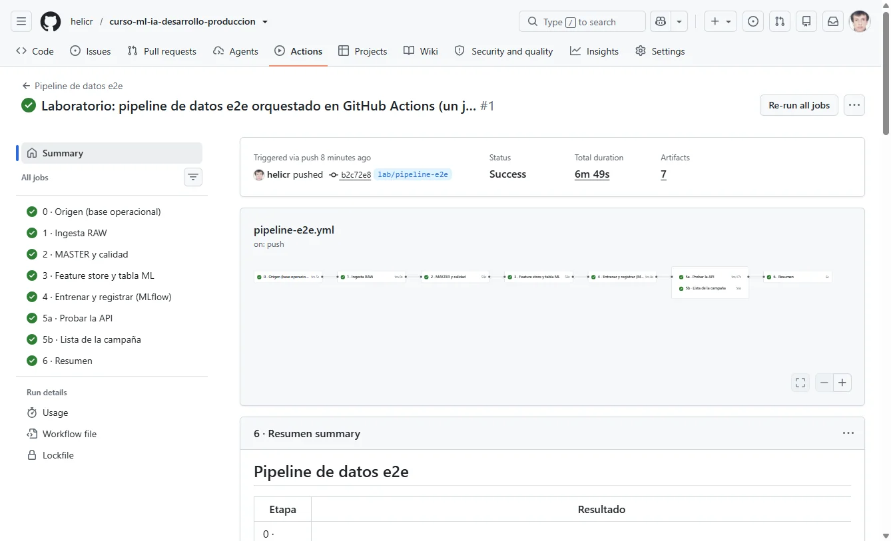

# Laboratorio de GitHub Actions: el pipeline de datos de punta a punta (S3 · ~30 min)

Es el paso siguiente al laboratorio [«romper y arreglar»](guia.md). Allí el workflow tenía **un solo job** que ejecutaba las pruebas. Aquí el workflow **es el pipeline del proyecto**: cada etapa (origen → RAW → MASTER → FS/ML → entrenar → API y campaña → resumen) es **un job**, y GitHub dibuja el grafo.

En tu copia del repositorio del curso (tu *fork*) vas a:

1. crear una rama `lab/pipeline-e2e`;
2. añadir el workflow [`pipeline-e2e.yml`](pipeline-e2e.yml) en `.github/workflows/`;
3. verlo correr en la pestaña **Actions**: el grafo, los pasos, los artefactos y el resumen;
4. (en casa) romper la etapa MASTER a propósito y ver qué pasa con las etapas siguientes.

Hoy no se usa Google Cloud ni se publica ninguna imagen: eso es de S4.

> **Estado de validación.** El workflow se ejecutó de verdad el 20/11/2026 en el repositorio del profesor, rama `lab/pipeline-e2e` (run [44783064449](https://github.com/helicr/curso-ml-ia-desarrollo-produccion/actions/runs/44783064449)): **los 8 jobs en verde**, 6 min 49 s de principio a fin, 7 artefactos. Los tiempos de este documento salen de ese run (API de GitHub). Lo que no se pudo ver (el aviso para activar Actions en un fork nuevo y el reto de la sección 6 ejecutado en GitHub) va marcado **(sin verificar)**.

---

## 1. La idea en un minuto

En tu Codespace el pipeline entero es **una orden**:

```bash
cd 04-Proyecto-Base
python -m ia_mlops.pipeline
```

`ia_mlops/pipeline.py` es solo un **orquestador**: no tiene lógica de datos, se limita a llamar en orden a `pipeline_ingesta_raw`, `pipeline_ingesta_master`, `pipeline_ml` y `pipeline_train`. Su docstring ya lo anunciaba: *«en S4 los lanzará GitHub Actions, cada uno como un paso»*. Hoy damos ese paso: **el orquestador pasa a ser GitHub Actions** y cada pipeline, un job.

Funciona porque los pipelines del proyecto ya estaban pensados así:

- **Independientes:** cada uno se puede ejecutar solo (`python -m ia_mlops.pipeline_ingesta_master`), comprueba que existe su entrada y, si falta, dice qué pipeline hay que ejecutar antes (`control.exigir`).
- **Idempotentes por huella:** `ia_mlops/control.py` calcula una *huella* (sha256) de la entrada de cada pipeline (los datos que lee + el código SQL/Python que aplica + la configuración) y la guarda en la tabla `control_pipelines`. Si la huella no cambió, el pipeline no hace nada; si falla a mitad, no registra su huella y la siguiente vez lo rehace entero. En Actions cada job parte de cero, así que siempre trabaja; en tu Codespace, la segunda ejecución apenas tarda.

### El grafo

```text
0 · Origen ──► 1 · RAW ──► 2 · MASTER ──► 3 · FS/ML ──► 4 · Entrenar ──┬──► 5a · Probar la API ──┐
 (retail.db)    (db-raw)    (db-master)     (db-ml)       (modelo)     │                        ├──► 6 · Resumen
                                                                        └──► 5b · Campaña ───────┘
```

Entre paréntesis, el **artefacto** que deja cada job para el siguiente.

Así lo dibuja GitHub en el **Summary** del run real (captura `e01-grafo-pipeline-e2e`):



### Tres ideas nuevas

| Idea | Qué es | Dónde está en el YAML |
|---|---|---|
| `needs:` | dice **de qué job depende** este job. Sin `needs:`, todos los jobs arrancarían a la vez. Con él, el job espera a que termine bien el anterior; si el anterior falla, este no se ejecuta | `raw:` tiene `needs: origen`; `resumen:` tiene `needs: [probar-api, campana]` (espera a los dos) |
| Dos jobs con el mismo `needs:` | corren **en paralelo** | `probar-api` y `campana` tienen los dos `needs: entrenar` |
| artefacto | un archivo (o carpeta) que un job **sube** al terminar y otro job **descarga**. Se guarda con el run (aquí, `retention-days: 3`) y se puede descargar desde la web | `actions/upload-artifact@v4` con `name: db-raw` … y en el siguiente job `actions/download-artifact@v4` con el **mismo** `name: db-raw` |

**Por qué hacen falta artefactos.** Cada job corre en **su propia máquina nueva y vacía** (`runs-on: ubuntu-latest`). Cuando termina el job RAW, su máquina se destruye y con ella `data/processed/curso.db`. Si el job MASTER no descargara la base, no tendría nada que limpiar: `pipeline_ingesta_master` diría que falta RAW. Por eso cada job empieza igual:

1. `actions/checkout@v4`: descarga el código;
2. `actions/setup-python@v5` + **Instalar**: Python 3.11 y las dependencias (`requirements-dev.txt`);
3. `actions/download-artifact@v4`: la base que dejó el job anterior;
4. **su** pipeline (una sola orden);
5. `actions/upload-artifact@v4`: la base actualizada, para el siguiente.

**El precio:** cada job instala las dependencias desde cero. En el run real, **instalar se lleva entre 30 y 49 s de cada job, y el pipeline de cada etapa entre 0 y 12 s** (tabla de la sección 4). Es el coste de tener las etapas separadas: se ven, se repiten y fallan por separado.

---

## 2. Guion del profesor (~28 min)

Antes de clase: deja abierto el run [44783064449](https://github.com/helicr/curso-ml-ia-desarrollo-produccion/actions/runs/44783064449) en una pestaña y el archivo [`pipeline-e2e.yml`](pipeline-e2e.yml) en otra (en GitHub, rama `lab/pipeline-e2e`, o en el editor).

| Min | Qué hacer | Qué decir / preguntar |
|---|---|---|
| 0–3 | En el Codespace, enseñar `python -m ia_mlops.pipeline` (o solo su salida) y el docstring de `ia_mlops/pipeline.py` | «Esto lo lanzáis vosotros a mano. ¿Qué pasa si mañana nadie se acuerda? ¿Y si queremos ver qué etapa falló?» |
| 3–6 | Dibujar el grafo de la sección 1 en la pizarra | **Pregunta:** «Si cada etapa corre en una máquina distinta, ¿cómo le llega a MASTER la base que hizo RAW?» → artefactos |
| 6–11 | Abrir `pipeline-e2e.yml`. Recorrer `on:`, `defaults:` y **dos** jobs seguidos (`raw` y `master`): `needs:`, `download-artifact` con `name: db-raw`, la orden, `upload-artifact` con `name: db-master` | Señalar que los nombres **tienen que coincidir** entre el `upload` de un job y el `download` del siguiente. **Pregunta:** «¿Qué dos jobs corren a la vez? ¿Cómo lo sabéis?» → `probar-api` y `campana`, mismo `needs: entrenar` |
| 11–13 | Pestaña **Actions** del repositorio: la lista de runs a la izquierda el workflow **Pipeline de datos e2e**; a la derecha, el run con su commit y la rama `lab/pipeline-e2e` | Igual que en el laboratorio anterior: un run por cada `push` a `lab/**` |
| 13–17 | Entrar en el run: página **Summary** con el **grafo** (una caja por job, unidas por líneas; 5a y 5b una encima de otra). Señalar la duración de cada caja | **Pregunta:** «¿Qué job tarda más? ¿Por qué tardan casi lo mismo todos?» → casi todo es instalar dependencias |
| 17–21 | Clic en la caja **2 · MASTER y calidad** → desplegar el paso **Instalar** (30 s en este job) y el paso **RAW → MASTER** (2 s): enseñar las reglas de calidad en el registro. Luego **4 · Entrenar y registrar (MLflow)** → paso **ML → modelo + MLflow** (12 s) | «El trabajo de verdad dura segundos; lo caro es preparar la máquina» |
| 21–24 | Volver al **Summary** y bajar hasta la sección de artefactos: los 7 (`operacional`, `db-raw`, `db-master`, `db-ml`, `modelo`, `api`, `campana`). **Descargar uno** (por ejemplo `campana`, el más pequeño: ~5 KB) y abrirlo: es un zip | «Esto es lo que se pasan los jobs. Caducan a los 3 días (`retention-days: 3`)» |
| 24–26 | En el mismo **Summary**, el bloque **Pipeline de datos e2e** que escribió el job **6 · Resumen**: la tabla de etapas, la predicción de la API, la salida del entrenamiento y la de la campaña | Lo escribe el job con `>> "$GITHUB_STEP_SUMMARY"`: cualquier texto en Markdown que escriba ahí aparece en la página del run |
| 26–28 | Cierre: los alumnos lanzan el suyo (sección 3) mientras se responde a dudas. Mencionar S4 (sección 7) | **Pregunta final:** «Si falla MASTER, ¿qué cajas se ejecutan?» → ninguna de las siguientes (sección 5) |

---

## 3. Pasos para el alumno

El archivo `pipeline-e2e.yml` **todavía no está en `develop`** del repositorio del curso: solo está en la rama `lab/pipeline-e2e` del repositorio del profesor. Por eso lo copiarás desde ahí:

<https://raw.githubusercontent.com/helicr/curso-ml-ia-desarrollo-produccion/lab/pipeline-e2e/.github/workflows/pipeline-e2e.yml>

**Antes de empezar (las dos rutas):** entra en la pestaña **Actions** de tu fork. En los forks, GitHub puede tener Actions desactivado al principio: **si ves un aviso** que pide activar los workflows, acéptalo (el texto exacto del botón: **sin verificar**). Si no ves aviso, no hay que hacer nada.

### Ruta A · Solo con la web de GitHub (sin Codespace)

1. **Rama.** En tu fork, en el selector de ramas (arriba a la izquierda, donde pone `develop` o la rama en la que estés), elige `develop`, escribe `lab/pipeline-e2e` y crea la rama a partir de `develop`.
2. **Copiar el YAML.** Abre en otra pestaña la URL *raw* de arriba, selecciona todo y copia.
3. **Crear el archivo.** Ya en tu rama `lab/pipeline-e2e`: **Add file → Create new file**. Como nombre escribe `.github/workflows/pipeline-e2e.yml` (al teclear las `/` GitHub crea las carpetas). Pega el contenido.
4. **Commit.** **Commit changes…**, con un mensaje como `Laboratorio: pipeline de datos e2e en GitHub Actions`, directamente en la rama `lab/pipeline-e2e` (no en `develop`).
5. **Ver Actions.** Pestaña **Actions** → **Pipeline de datos e2e** → el run de tu commit. Sigue la sección 4.

### Ruta B · Por terminal (Codespace)

```bash
git switch develop
git pull
git switch -c lab/pipeline-e2e
mkdir -p .github/workflows
cp 01-Sesiones/S3-Despliegue-y-Redes-Neuronales/laboratorio-github-actions/pipeline-e2e.yml .github/workflows/
git status
```

Si `cp` dice que el archivo no existe (porque tu `develop` aún no lo tiene), descárgalo de la rama del profesor:

```bash
curl -fsSL -o .github/workflows/pipeline-e2e.yml \
  https://raw.githubusercontent.com/helicr/curso-ml-ia-desarrollo-produccion/lab/pipeline-e2e/.github/workflows/pipeline-e2e.yml
```

Después:

```bash
git add .github/workflows/pipeline-e2e.yml
git commit -m "Laboratorio: pipeline de datos e2e en GitHub Actions"
git push -u origin lab/pipeline-e2e
```

**Si falla:** si git pide nombre y correo, configúralos una vez con `git config user.name "Tu nombre"` y `git config user.email "tu-correo"` y repite el commit.

**No choca con el laboratorio anterior.** Si tu fork ya tiene `.github/workflows/pruebas-proyecto.yml` en la rama de la que partes, también se disparará (las dos escuchan `lab/**`): verás **dos** runs por cada `push`. Es normal.

---

## 4. Qué debes ver

En **Actions** aparece un run de **Pipeline de datos e2e**; en su **Summary**, el grafo con 8 cajas que se van poniendo en verde de izquierda a derecha, y 5a y 5b a la vez.

Tiempos reales del run del profesor (20/11/2026, primer run de la rama):

| Job | Duración | Instalar | Su etapa |
|---|---|---|---|
| 0 · Origen (base operacional) | 1 min 5 s | 49 s | Crear la base operacional con la muestra: 1 s |
| 1 · Ingesta RAW | 1 min 0 s | 47 s | retail.db → RAW: 1 s |
| 2 · MASTER y calidad | 59 s | 30 s | RAW → MASTER: 2 s |
| 3 · Feature store y tabla ML | 58 s | 42 s | MASTER → FS → ML: menos de 1 s |
| 4 · Entrenar y registrar (MLflow) | 1 min 8 s | 44 s | ML → modelo + MLflow: 12 s |
| 5a · Probar la API | 1 min 17 s | 48 s | Arrancar la API y pedir una predicción: 6 s |
| 5b · Lista de la campaña | 56 s | 42 s | Puntuar a todos los clientes y elegir el 10 %: 3 s |
| 6 · Resumen | 6 s | — (no instala nada) | Escribir el resumen del run: menos de 1 s |
| **Run completo** | **6 min 49 s** | | 5a y 5b en paralelo |

Tus tiempos serán parecidos, no iguales: dependen de la máquina que te toque y de la caché de pip.

Además:

- **Artefactos** (abajo del Summary): `operacional`, `db-raw`, `db-master`, `db-ml`, `modelo`, `api` y `campana`.
- **Resumen** escrito por el job 6: la tabla de etapas, la respuesta de `/predecir` (con su `probabilidad`) y la salida del entrenamiento y de la campaña.
- En el job **5a**, dentro de **Arrancar la API y pedir una predicción**: la respuesta de `/listo`, la de `/predecir` (con `tests/datos/cliente_ejemplo.json`) y una línea `probabilidad …`.

### Si falla

| Lo que ves | Causa probable | Qué hacer |
|---|---|---|
| No aparece ningún run | El archivo no está en `.github/workflows/` (con punto) en la **raíz**; la rama no empieza por `lab/`; o Actions está desactivado en tu fork | Revisa la ruta y el nombre de la rama; mira el aviso de la pestaña **Actions** (sección 3) |
| El run falla sin llegar a los jobs | **YAML mal sangrado** (o con tabuladores) al pegar | En YAML la sangría es la sintaxis: dos espacios por nivel. Vuelve a copiar desde la URL *raw*, sin retocar |
| Un job falla en `download-artifact` con un error de artefacto no encontrado | El `name:` del `upload-artifact` de un job y el del `download-artifact` del siguiente **no coinciden** | Compara los dos `name:` (por ejemplo `db-raw` y `db-raw`) |
| Un job falla y los siguientes salen en **gris**, como *skipped* (omitidos) | Es lo esperado: con `needs:`, si un job falla, los que dependen de él **no se ejecutan** | Busca la **primera caja roja** del grafo y su paso rojo: ahí está el error; las grises no tienen nada que leer |
| MASTER falla con `Fallaron reglas de calidad duras` | Una regla de calidad **dura** no se cumple (`ia_mlops/calidad.py`) | Lee qué regla y qué valor en el registro del paso **RAW → MASTER** |

---

## 5. Por qué está separado en jobs (y no en pasos de un solo job)

Se podría hacer todo en un job con cuatro pasos (se ahorraría instalar 7 veces). Separarlo en jobs da:

- **Visibilidad:** el grafo dice de un vistazo **qué etapa** falló.
- **Paralelismo:** 5a y 5b corren a la vez.
- **Entregas intermedias:** cada etapa deja su base como artefacto; se puede descargar la de MASTER para investigar sin repetir nada.
- **Reintentos acotados:** GitHub permite volver a ejecutar solo los jobs que fallaron.

El precio es el tiempo de instalar en cada máquina. En un proyecto real se reduce con una imagen de contenedor ya preparada (S4).

---

## 6. Ejercicio para casa (reto)

### Reto 1 · Romper MASTER y ver el grafo en gris (sin verificar en GitHub)

Las reglas de calidad están en `04-Proyecto-Base/ia_mlops/calidad.py`. La regla **R01_conciliacion** (dura) exige que las líneas de RAW sean exactamente las de MASTER más las descartadas: su valor es 0 y su criterio, `cero`. Cambia **solo el criterio** de esa regla para que exija otra cosa:

```python
         'duro', '= 0', cero),          # en la línea de R01_conciliacion…
         'duro', '= 0', lambda v: v == 1),   # …ponlo así (rotura a propósito)
```

(Edita solo la línea de `R01_conciliacion`: hay otras reglas con el mismo final.) Haz commit y `push` a `lab/pipeline-e2e` (o, en la web, edita el archivo con el lápiz y haz commit en esa rama).

**Qué deberías ver:** 0 y 1 en verde; **2 · MASTER y calidad** en rojo, con `Fallaron reglas de calidad duras` y `R01_conciliacion` en el paso **RAW → MASTER**; 3, 4, 5a, 5b y 6 sin ejecutar (*skipped*). Después, arréglalo con `git revert --no-edit HEAD` y `git push`, como en el laboratorio anterior.

**Pregunta:** ¿cuántos artefactos tiene ese run? ¿Por qué no hay `db-master`?

### Reto 2 · Añadir un job en paralelo

Añade un job `pruebas` que ejecute las pruebas del laboratorio anterior en paralelo con el origen (sin `needs:`), y haz que `resumen` lo espere (`needs: [probar-api, campana, pruebas]`). Pista: los pasos son los de `pruebas-proyecto.yml`. **Qué deberías ver:** en el grafo, una caja nueva que arranca a la vez que **0 · Origen** y una línea más hacia **6 · Resumen**.

---

## 7. Qué viene en S4

Solo para situarnos; se trabaja en S4:

- **Publicar la imagen** del proyecto en Artifact Registry desde el workflow.
- **Desplegar con aprobación:** un job que espera a que una persona autorizada lo apruebe (*environments* protegidos de GitHub).
- **Autenticación con GCP sin claves:** *Workload Identity Federation*. Ninguna clave guardada en el repositorio.

## 8. Autoevaluación

1. ¿Qué línea hace que MASTER espere a RAW? → `needs: raw` en el job `master`.
2. ¿Por qué cada job descarga un artefacto? → porque cada job corre en una máquina nueva y vacía: la base del job anterior no está ahí.
3. ¿Por qué 5a y 5b corren a la vez? → porque los dos tienen `needs: entrenar` y nada más.
4. En el run real, ¿en qué se va casi todo el tiempo de cada job? → en **Instalar** (30–49 s), no en la etapa (0–12 s).
5. Si falla MASTER, ¿qué pasa con FS/ML, entrenar, API, campaña y resumen? → no se ejecutan (*skipped*).
6. ¿Qué aporta `control.py` en tu Codespace que en Actions no se nota? → la idempotencia por huella: si la entrada no cambió, el pipeline no hace nada. En Actions cada job empieza de cero.
