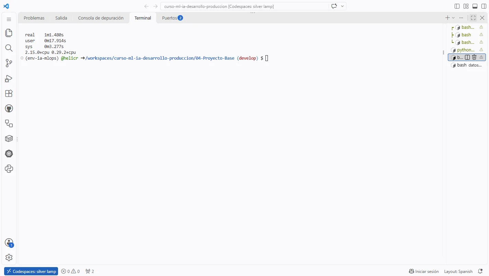
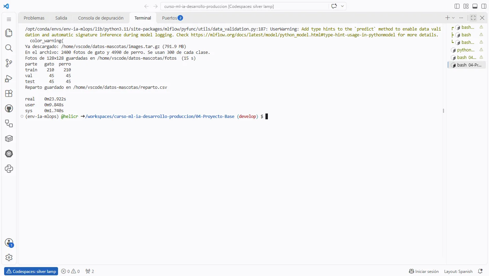
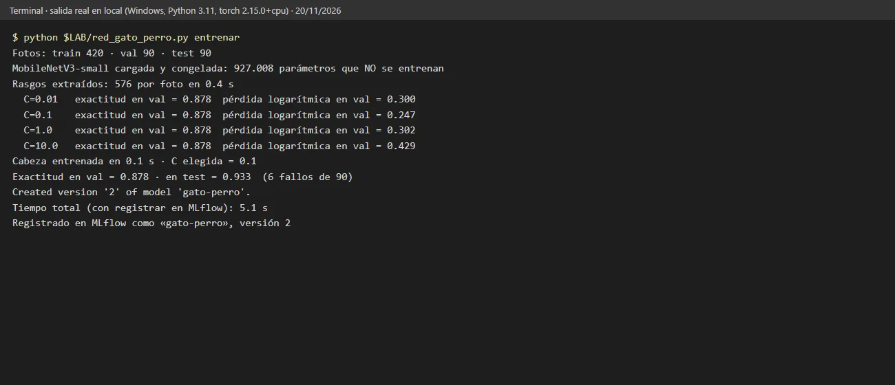
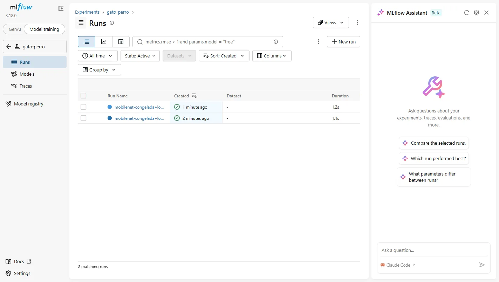
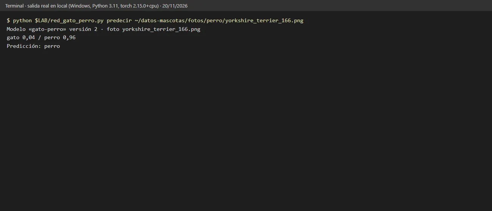

# Laboratorio de red neuronal (S3, 30 min): ¿perro o gato?

Usas una red ya entrenada con ImageNet (**MobileNetV3-small**), la dejas **congelada** y entrenas solo una **cabeza**
(regresión logística sobre sus 576 rasgos) con fotos reales de Oxford-IIIT Pet a 128×128. Después la registras en MLflow
con su firma y predices una foto. Todo con un solo script: `red_gato_perro.py` (subórdenes `datos`, `entrenar`, `predecir`).

La presentación es `index.html` (se genera con `python generar.py`). Las salidas que se citan son **reales** (ejecución en
local, 20/11/2026); en el Codespace los tiempos y el número de versión pueden cambiar.

## 1. La idea en dos frases

- Una **neurona** multiplica cada entrada por un peso, suma y aplica una función (la regresión logística es una neurona).
  Una **CNN** (red convolucional) apila capas de filtros que recorren la imagen: las primeras ven bordes, las últimas partes
  como orejas u ojos. Al final quedan unos **rasgos**: 576 números por foto.
- **Transferencia**: la red grande (927 008 parámetros) no se toca; solo se entrenan los 577 pesos de la cabeza. Ojo:
  ImageNet **ya contiene perros y gatos**, así que la red ya sabe bastante de ellos; por eso basta con pocos datos.

Cifras del estudio previo (`00-Planificacion/s3/_pico_red_neuronal/INFORME.md`): **93,1 %** en 720 fotos de test (IC95
91,1–94,9 %); entrenar la cabeza en vivo 1,5 s (7,6 s con exportar y registrar); pesos de MobileNetV3-small 10,3 MB; una
CNN propia desde cero con CIFAR-10 tardó 566 s para 86,4 %.

## 2. Los datos y su licencia

- Oxford-IIIT Pet, archivo `images.tar.gz` (791,9 MB). Inicial **mayúscula = gato**, minúscula = perro.
- Licencia **CC BY-SA 4.0** (página oficial de VGG, Universidad de Oxford); los derechos de cada foto siguen en sus autores.
- Cita: Parkhi, Vedaldi, Zisserman, Jawahar, «Cats and Dogs», CVPR 2012.
- Las fotos se guardan en `~/datos-mascotas/`, fuera del repositorio.

## 3. Instalar (3 min)

```bash
cd /workspaces/curso-ml-ia-desarrollo-produccion/04-Proyecto-Base
conda activate env-ia-mlops
pip install -q torch torchvision --index-url https://download.pytorch.org/whl/cpu
```

En el Codespace del curso tardó 1 min 21 s y dejó `torch 2.15.0+cpu` y `torchvision 0.29.2+cpu`. `mlflow`, `scikit-learn`
y `pillow` ya están en el entorno. Versiones exactas probadas: `requisitos.txt`.



## 4. Preparar las fotos (3 min)

```bash
LAB=../01-Sesiones/S3-Despliegue-y-Redes-Neuronales/laboratorio-red-neuronal
python $LAB/red_gato_perro.py datos
```

Descarga el archivo si no está ya en `~/datos-mascotas/`, elige 300 fotos por clase con semilla 42, las recorta al centro y
reduce a 128×128, y las reparte 70/15/15. Si va lento: `python $LAB/red_gato_perro.py datos --por-clase 100`.

```text
Descargando https://www.robots.ox.ac.uk/~vgg/data/pets/data/images.tar.gz (unos 792 MB) ...
   10 %  (80 MB, 13 s)
  ...
  100 %  (792 MB, 99 s)
En el archivo: 2400 fotos de gato y 4990 de perro. Se usan 300 de cada clase.
Fotos de 128×128 guardadas en …/datos-mascotas/fotos  (8 s)
parte   gato  perro
train    210    210
val       45     45
test      45     45
```



## 5. Entrenar la cabeza y registrar en MLflow (4 min)

```bash
python $LAB/red_gato_perro.py entrenar
```

```text
Fotos: train 420 · val 90 · test 90
MobileNetV3-small cargada y congelada: 927.008 parámetros que NO se entrenan
Rasgos extraídos: 576 por foto en 0.4 s
  C=0.01   exactitud en val = 0.878  pérdida logarítmica en val = 0.300
  C=0.1    exactitud en val = 0.878  pérdida logarítmica en val = 0.247
  C=1.0    exactitud en val = 0.878  pérdida logarítmica en val = 0.302
  C=10.0   exactitud en val = 0.878  pérdida logarítmica en val = 0.429
Cabeza entrenada en 0.1 s · C elegida = 0.1
Exactitud en val = 0.878 · en test = 0.933  (6 fallos de 90)
Tiempo total (con registrar en MLflow): 5.8 s
Registrado en MLflow como «gato-perro», versión 3
```

`C` se elige en validación (si empatan, la de menor pérdida logarítmica); test solo se informa. La primera vez se descargan
los pesos de MobileNet. Los avisos `UserWarning` o `WARNING` de MLflow no son errores.



## 6. Verlo en MLflow (3 min)

Si no tienes abierta la interfaz del laboratorio de MLflow, en un segundo terminal:

```bash
cd /workspaces/curso-ml-ia-desarrollo-produccion/04-Proyecto-Base
conda activate env-ia-mlops
python -m ia_mlops.mlflow_ui
```

Puerto 5000 → **Model training** → Experiments → `gato-perro`: parámetros (`C`, `red_base`, `lado`…), métricas
(`exactitud_val`, `exactitud_test`…) y, en el modelo, la **firma**: entrada `imagen` uint8 (-1, 128, 128, 3); salida
`probabilidades` float32 (-1, 2). En «Registered Models» está `gato-perro` con sus versiones.

Si `mlflow_ui` dice «Está vacío» (no hay ejecuciones de `retencion-90d`), plan B:

```bash
python -m mlflow ui --backend-store-uri "$(python -c 'from ia_mlops import mlflow_ui; print(mlflow_ui.uri())')" --port 5000
```



## 7. Predecir una foto (3 min)

```bash
python $LAB/red_gato_perro.py predecir ~/datos-mascotas/fotos/perro/yorkshire_terrier_166.png
python $LAB/red_gato_perro.py predecir ~/datos-mascotas/fotos/gato/Abyssinian_142.png
```

```text
Modelo «gato-perro» versión 3 · foto yorkshire_terrier_166.png
gato 0,04 / perro 0,96
Predicción: perro
```

```text
Modelo «gato-perro» versión 3 · foto Abyssinian_142.png
gato 0,55 / perro 0,45
Predicción: gato
```

Prueba con tu foto: arrástrala al explorador del Codespace y pon su ruta. El script aplica el mismo recorte y reducción.



## 8. Qué significa 93 %

93 % quiere decir que **7 de cada 100 fotos fallan**. Hoy: 93,3 % en 90 fotos de test (6 fallos); con tan pocas fotos,
unos puntos arriba o abajo son azar (el estudio previo, con 720, dio 93,1 %). El modelo **siempre** elige gato o perro,
aunque la foto sea de otra cosa; una probabilidad cerca de 0,5 indica duda.

## 9. Siguiente paso (no se hace hoy)

Una API como la de S2 que reciba la imagen. Para que el contenedor sea ligero, exportar a ONNX y servir con ONNX Runtime:
unos 264 MB de paquetes frente a unos 982 MB con PyTorch (estudio previo).

## 10. Autoevaluación

1. ¿Qué parte de la red hemos entrenado? — Solo la cabeza; MobileNet estaba congelada.
2. ¿Por qué funciona con 420 fotos? — Transferencia: MobileNet ya aprendió a ver con ImageNet, que incluye perros y gatos.
3. ¿Qué dice la firma? — Entrada: lote de imágenes uint8 128×128×3; salida: 2 probabilidades (gato, perro).

Al terminar puedes borrar `~/datos-mascotas/` (unos 800 MB).
